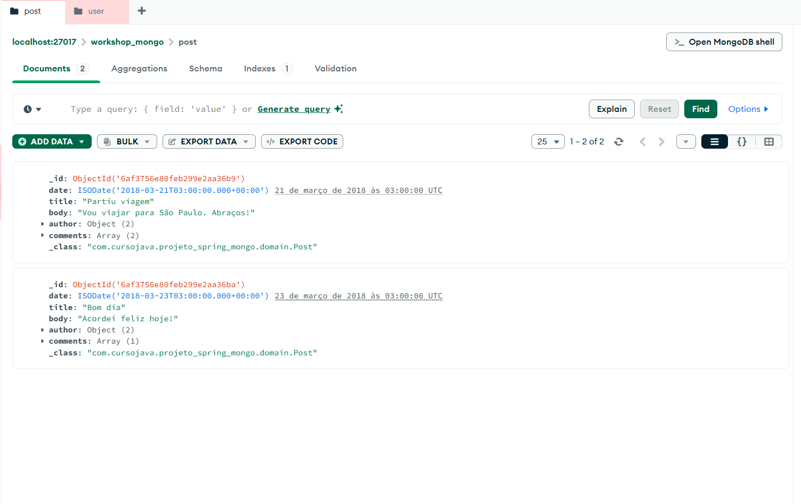
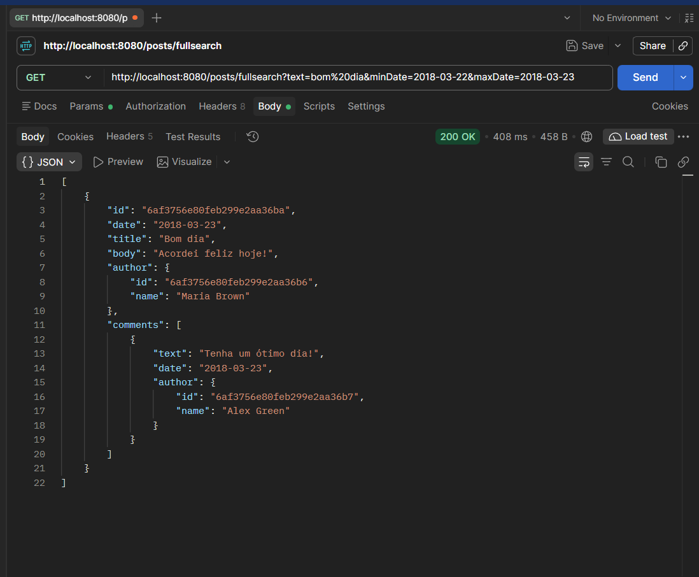

# Workshop Spring Boot + MongoDB

API REST de estudo com Spring Boot e Spring Data MongoDB. Usuários publicam posts, e cada post carrega comentários embutidos.

Ao iniciar, a aplicação grava dados de exemplo e expõe CRUD de usuários e consultas de posts (busca por título, texto completo e intervalo de datas).

## 🖼️ Demonstração

### Banco de dados — MongoDB Compass


### Testes da API — Postman


## Stack

| Tecnologia | Versão |
| --- | --- |
| Java | 25 |
| Spring Boot | 4.1.2 |
| Spring Web MVC | `spring-boot-starter-webmvc` |
| Spring Data MongoDB | `spring-boot-starter-data-mongodb` |
| MongoDB | local, porta `27017` |
| Build | Maven (wrapper incluso) |

## Pré-requisitos

- JDK 25
- MongoDB rodando em `localhost:27017`

A conexão é configurada em `src/main/resources/application.properties`:

```properties
spring.mongodb.uri=mongodb://localhost:27017/workshop_mongo
```

## Como executar

Na raiz do projeto, com o MongoDB no ar:

```bash
# Windows
mvnw.cmd spring-boot:run

# Linux / macOS
./mvnw spring-boot:run
```

A API sobe em `http://localhost:8080`.

Para gerar o JAR:

```bash
mvnw.cmd clean package
java -jar target/Projeto_Spring_Mongo-0.0.1-SNAPSHOT.jar
```

### Dados de exemplo

> **Atenção:** a classe `Instantiation` roda a cada inicialização, **apaga** as collections `user` e `post` e grava os dados abaixo novamente. Tudo que for criado pela API é perdido na próxima subida.

| Usuário | E-mail |
| --- | --- |
| Maria Brown | maria@gmail.com |
| Alex Green | alex@gmail.com |
| Bob Grey | bob@gmail.com |

Maria é autora de dois posts (`Partiu viagem` e `Bom dia`), com comentários de Alex e Bob.

## Modelo de dados

Banco: `workshop_mongo`.

```text
user                         post
────                         ────
id                           id
name                         date
email                        title
posts  ──DBRef──►            body
                             author   (AuthorDTO embutido: id, name)
                             comments (lista de CommentDTO: text, date, author)
```

- **User** (collection `user`): os posts são uma referência `DBRef` carregada sob demanda.
- **Post** (collection `post`): autor e comentários ficam embutidos no documento.
- **AuthorDTO**: guarda apenas `id` e `name`, evitando duplicar o usuário inteiro no post.

## Endpoints

Base: `http://localhost:8080`

### Usuários — `/users`

| Método | Caminho | Descrição | Resposta |
| --- | --- | --- | --- |
| `GET` | `/users` | Lista usuários (`id`, `name`, `email`) | 200 |
| `GET` | `/users/{id}` | Busca um usuário | 200 |
| `POST` | `/users` | Cria usuário (`id` gerado pelo MongoDB) | 201 + header `Location` |
| `PUT` | `/users/{id}` | Atualiza nome e e-mail | 204 |
| `DELETE` | `/users/{id}` | Remove o usuário | 204 |
| `GET` | `/users/{id}/posts` | Lista os posts do usuário | 200 |

Criar usuário:

```bash
curl -i -X POST http://localhost:8080/users \
  -H "Content-Type: application/json" \
  -d "{\"name\":\"Ana Souza\",\"email\":\"ana@email.com\"}"
```

Corpo do `PUT`:

```json
{
  "name": "Ana Souza",
  "email": "ana.souza@email.com"
}
```

### Posts — `/posts`

| Método | Caminho | Descrição |
| --- | --- | --- |
| `GET` | `/posts/{id}` | Busca um post com autor e comentários |
| `GET` | `/posts/findtitle?text=` | Título contém o texto, sem diferenciar maiúsculas (query method) |
| `GET` | `/posts/searchtitle?text=` | Mesma busca, usando `@Query` com `$regex` |
| `GET` | `/posts/fullsearch?text=&minDate=&maxDate=` | Texto no título, corpo ou comentários, dentro do intervalo de datas |

Em `fullsearch`, as datas usam o formato `yyyy-MM-dd`:

- Sem `minDate`: considera a partir de `1900-01-01`.
- Sem `maxDate`: considera até hoje. O dia inteiro é incluído porque o serviço soma um dia antes de aplicar `$lt`.

Os parâmetros de texto são decodificados em UTF-8, então buscas com acento funcionam.

```bash
curl "http://localhost:8080/posts/findtitle?text=viagem"
curl "http://localhost:8080/posts/fullsearch?text=dia&minDate=2018-03-01&maxDate=2018-03-31"
```

### Erros

Recurso inexistente retorna **404**:

```json
{
  "timestamp": 1710000000000,
  "status": 404,
  "error": "Não encontrado",
  "mensage": "User not found",
  "path": "/users/id-inexistente"
}
```

Para posts, a mensagem é `Post not found`.

## O que o projeto pratica

- Mapeamento com `@Document`, `@Id` e `@DBRef(lazy = true)`
- `MongoRepository` com query methods e `@Query` em sintaxe MongoDB
- Camadas Resource, Service e Repository
- DTOs para limitar o que a API de usuários expõe
- Documento embutido (`CommentDTO` em `Post`) e referência (`User` → `Post`)
- Tratamento global de exceções com `@ControllerAdvice`
- Carga inicial com `CommandLineRunner`

### Consultas em `PostRepository`

- **Query method:** `findByTitleContainingIgnoreCase`
- **Regex manual:** `{ 'title': { '$regex': ?0, '$options': 'i' } }`
- **Busca composta:** `$and` entre o intervalo de `date` e um `$or` em `title`, `body` e `comments.text`

## Estrutura

```text
src/main/java/com/cursojava/projeto_spring_mongo
├── ProjetoSpringMongoApplication.java
├── config/Instantiation.java          carga inicial
├── domain/                            User, Post
├── dto/                               UserDTO, AuthorDTO, CommentDTO
├── repository/                        UserRepository, PostRepository
├── resources/                         UserResource, PostResource
│   ├── exceptions/                    ControllerAdvice e corpo do erro
│   └── util/URL.java                  decode e parse de datas
└── services/                          UserService, PostService
```

## Licença

Projeto de estudo, sem licença definida.
